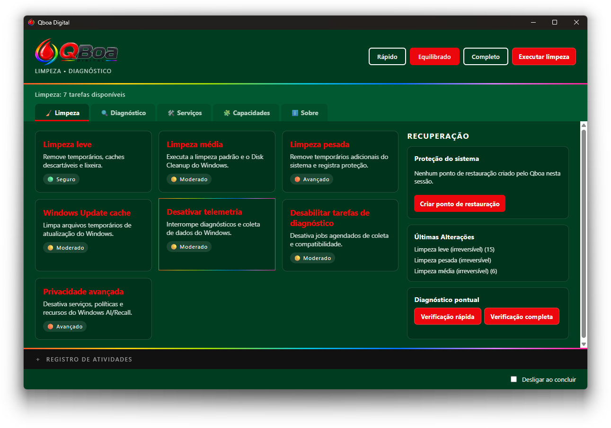
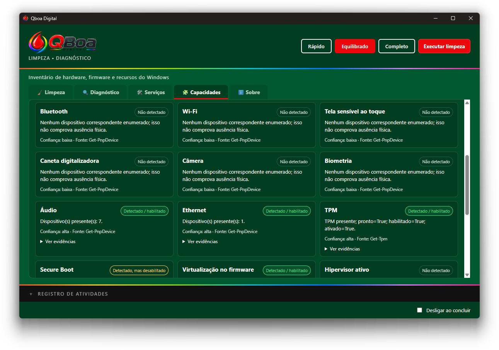
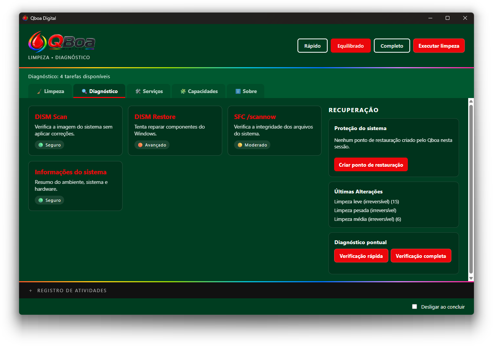
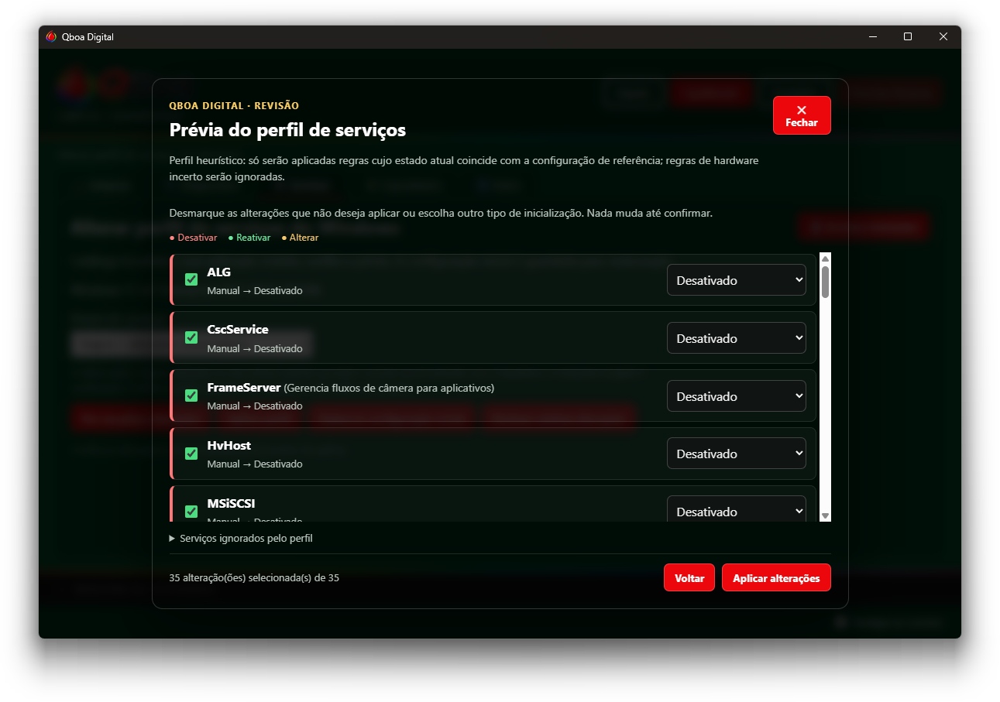

# QBoa Digital — hotsite oficial

O **QBoa Digital** é um utilitário open source para Windows 10 e 11 que reúne limpeza, privacidade, manutenção e diagnósticos de hardware. A ideia é simples: deixar o usuário no comando, explicar o que vai acontecer e evitar aquela faxina que começa tirando poeira e termina derrubando a parede. 😄

O aplicativo desktop é desenvolvido com **Tauri e Rust**. Limpeza e diagnóstico são áreas independentes: uma coisa não se mistura com a outra, e os resultados dos diagnósticos ficam guardados em laudos JSON persistentes.

## Situação da versão

- **3.2.3 — publicada:** versão estável disponível para Windows x64.
- **3.2.2 — publicada:** versão anterior, disponível no histórico de releases.
- **3.2.1 — publicada:** versão anterior, disponível no histórico de releases.

## Roadmap — QBoa Pro 3.3

A 3.3 está em desenvolvimento. O foco é transformar o QBoa em uma bancada de ferramentas técnicas para diagnóstico, manutenção e personalização do Windows — sem misturar diagnóstico com limpeza.

- **Inventário técnico completo:** hardware, Windows, componentes, drivers e informações úteis para atendimento.
- **Diagnóstico de rede:** reunir verificações e informações de conectividade para ajudar a localizar problemas.
- **Central de reparo do Windows:** fluxos guiados para SFC, DISM e Windows Update, com explicações, confirmação e registro da execução.
- **Auditoria de programas e inicialização:** inventário e análise; nesta etapa, sem automação de remoção.
- **Personalização de componentes do Windows:** opções de configuração com prévia e controle.
- **Laudo em PDF personalizado:** relatório técnico com logo do profissional/empresa e informações OEM.
- **Atualização assistida do QBoa:** facilitar a manutenção da própria ferramenta.

A ideia é lançar uma base sólida e segura. Auditoria de drivers, comparação de inventários, backup/restauração de configurações e auditoria de segurança ficam como possíveis incrementos posteriores; gestão de ordens de serviço e clientes é uma etapa futura, não promessa da 3.3. Escopo e ordem podem mudar conforme validação.

## Galeria

Capturas das principais áreas do QBoa Digital. As imagens preservam a transparência e a sombra originais das janelas do Windows.

  
  
<strong>Limpeza</strong>

  
  
<strong>Capacidades do Windows</strong>

  
  
<strong>Diagnóstico</strong>

  
  
<strong>Serviços do Windows</strong>

## Baixe a versão estável

A **3.2.3** é a versão estável publicada. Escolha como prefere levar o QBoa:

- **[Baixar instalador para Windows (x64)](https://github.com/bloodshinoda/qboa-digital/releases/download/v3.2.3/qboa-digital-3.2.3-x64-installer.exe)** — instalação tradicional.
- **[Baixar versão portátil para Windows (x64)](https://github.com/bloodshinoda/qboa-digital/releases/download/v3.2.3/qboa-digital-3.2.3-x64-portable.exe)** — um executável individual, sem ZIP para descompactar.
- [Notas e arquivos da release 3.2.3](https://github.com/bloodshinoda/qboa-digital/releases/tag/v3.2.3)
- [Código-fonte do aplicativo](https://github.com/bloodshinoda/qboa-digital)

> A 3.2.3 já está publicada. Agora sim, pode baixar sem invocar erro 404. 😉

## Histórico de versões

### 3.2.3 — Mais segurança, progresso e controle *(publicada em 11/11/2026)*

- A criação do ponto de restauração acontece durante a preparação, antes de liberar o início da tarefa.
- Se o Windows não conseguir criar o ponto, o usuário decide explicitamente se deseja prosseguir; a autorização fica vinculada à tarefa preparada, tem validade limitada e não pode ser reutilizada.
- A proteção também contempla operações de manutenção, mantendo os diagnósticos independentes.
- Progresso contínuo de 0% a 100% durante toda a operação, com contribuição dos percentuais reais de DISM RestoreHealth, ResetBase e SFC dentro do peso de cada etapa.
- Falhas e cancelamentos não são apresentados como conclusão bem-sucedida.
- Glow aplicado somente ao campo em atividade, com transição suave.

**Status:** publicada. Os downloads acima já apontam para a 3.2.3.

### 3.2.2 — Mais fluidez e personalidade *(publicada em 04/11/2026)*

Esta atualização é um polimento da experiência de uso, não uma leva de funcionalidades novas:

- Registro de Atividades com altura redimensionável, persistida entre execuções.
- Alça de redimensionamento com suporte a teclado e comportamento mais intuitivo.
- Progresso das operações também indicado no ícone do QBoa na barra de tarefas do Windows.
- Mensagens variadas em cada etapa, com cinco opções por categoria para evitar a sensação de replay.
- Frases especiais e easter eggs ocasionais — incluindo a participação honorária do QBoa e do dízimo. 😄
- Animações discretas, respeitando a preferência do Windows por movimento reduzido.

**Status:** publicada. Os downloads acima já apontam para a 3.2.2.

### 3.2.1 — Limpeza nativa e níveis de execução

- Substitui a dependência do Cleanmgr e de scripts PowerShell por rotinas próprias em Rust nas áreas de limpeza implementadas.
- Organiza a faxina em três níveis: **leve, intermediário e pesado**, com escopo e impacto crescentes.
- Limpeza leve focada em temporários e caches comuns; a intermediária também inclui downloads do Windows Update e caches Adobe conhecidos.
- Limpeza pesada reúne rotinas avançadas, resíduos de falhas e manutenção DISM/SFC.
- Rebase com `/ResetBase` é opcional e condicionado à compatibilidade do ambiente. Em sistemas modificados, restritivos ou incertos, a operação é ignorada para preservar possibilidades de rollback.
- Verificações conservadoras evitam remover arquivos quando o estado do sistema não é conclusivo.

### 3.2.0 — Diagnósticos de hardware

- Testes próprios de integridade da memória RAM, com perfis de execução, inventário dos módulos, progresso e cancelamento.
- Teste de carga da CPU com monitoramento térmico opcional e proteção contra condições inseguras.
- Teste de estabilidade da GPU baseado em Direct3D 11 Compute Shader, com validação independente e proteções térmicas.
- Diagnóstico completo com aviso e confirmação prévios, progresso por etapa, cancelamento e resumo consolidado.
- Laudos JSON versionados, histórico local e preservação de resultados parciais em execuções interrompidas.
- Diagnósticos separados das ferramentas de limpeza e manutenção. Cada coisa no seu quadrado — e cada laudo no seu lugar.

### 3.1.2 — Prévia de serviços mais confiável

- Corrige sugestões heurísticas de serviços no Windows 11 IoT Enterprise LTSC.
- Só sugere ajustes quando o estado atual do serviço coincide com a referência do catálogo; divergências são ignoradas.
- Identifica fornecedores conhecidos e apresenta evidências, sem transformar identificação em recomendação automática para desativar serviços.
- Mantém prévia e confirmação explícita antes de aplicar mudanças.

### 3.1.1 — Progresso e confirmações mais claras

- Painel de progresso centralizado, com contraste aprimorado e comportamento indeterminado quando não há percentual real.
- Confirmações e avisos de risco ficam em primeiro plano; o progresso não disputa atenção com uma decisão pendente.
- Bloqueio de tarefas concorrentes na interface e no backend Rust.
- Descrições em linguagem simples para serviços conhecidos na prévia de ajustes.

### 3.1.0 — Mais visibilidade e controle

- Inventário de capacidades e recursos detectados no Windows.
- Consulta e ajustes de serviços compatíveis, com registro do estado anterior para rollback quando reversíveis.
- Resumo das tarefas de limpeza com indicação de sucesso, falha ou cancelamento.
- Aba **Sobre** com versão, autoria e QR Code Pix.
- Melhorias nos diálogos de confirmação, no diagnóstico de armazenamento e na leitura opcional de temperatura da CPU com provedor compatível.

### 3.0 — Nova geração desktop

- Transição dos scripts BAT para um aplicativo desktop com Tauri e Rust.
- Primeira organização das rotinas de manutenção em sequências de execução.
- Limpeza, ferramentas de privacidade e telemetria, DISM e SFC.
- Confirmações para tarefas avançadas e proteções por pontos de restauração e rollback para alterações reversíveis.

## O que o aplicativo reúne

- Limpeza de arquivos temporários e caches selecionados, organizada por níveis.
- Ferramentas de privacidade e ajustes relacionados à telemetria.
- Consulta e gerenciamento de serviços do Windows, com prévia das alterações.
- Diagnósticos de armazenamento, memória RAM, CPU e GPU.
- Laudos técnicos persistentes e histórico dos diagnósticos.
- Manutenção do Windows com DISM e SFC.
- Registro de atividades e possibilidade de cancelar operações compatíveis.

Operações como remoção de arquivos, verificações e reparos do Windows não possuem rollback granular. A disponibilidade de pontos de restauração depende da configuração do próprio Windows. Leia as informações e confirmações apresentadas pelo aplicativo antes de executar tarefas avançadas — a ideia é limpar o sistema, não fazer uma limpeza espiritual no disco inteiro.

## Versões legadas BAT

As versões anteriores continuam disponíveis para quem prefere os scripts originais:

- **[QBoa Digital 1.0 BAT](download/qboa-digital-1.0.zip)** — rotinas simples.
- **[QBoa Digital 2.0 BAT](download/qboa-digital-2.0.zip)** — evolução dos scripts, com rotinas adicionais de otimização.

A linha 3.x é uma nova geração do projeto, não um apagamento da história do BAT. O propósito continua o mesmo; a ferramenta é que ganhou uma casa nova.

## Repositórios

- [Código-fonte do aplicativo e releases](https://github.com/bloodshinoda/qboa-digital)
- [Repositório deste hotsite](https://github.com/qboadigital/qboadigital.github.io)

## Licenças

O conteúdo deste site é licenciado sob a [Creative Commons Attribution-ShareAlike 4.0 International (CC BY-SA 4.0)](LICENSE). Você pode compartilhar e adaptar o material, desde que atribua a autoria e distribua eventuais adaptações sob a mesma licença.

O aplicativo QBoa Digital e seu código-fonte são licenciados sob a GNU General Public License v3.0 (GPL-3.0). Consulte o [repositório do aplicativo](https://github.com/bloodshinoda/qboa-digital) para os termos e o código-fonte correspondentes.
