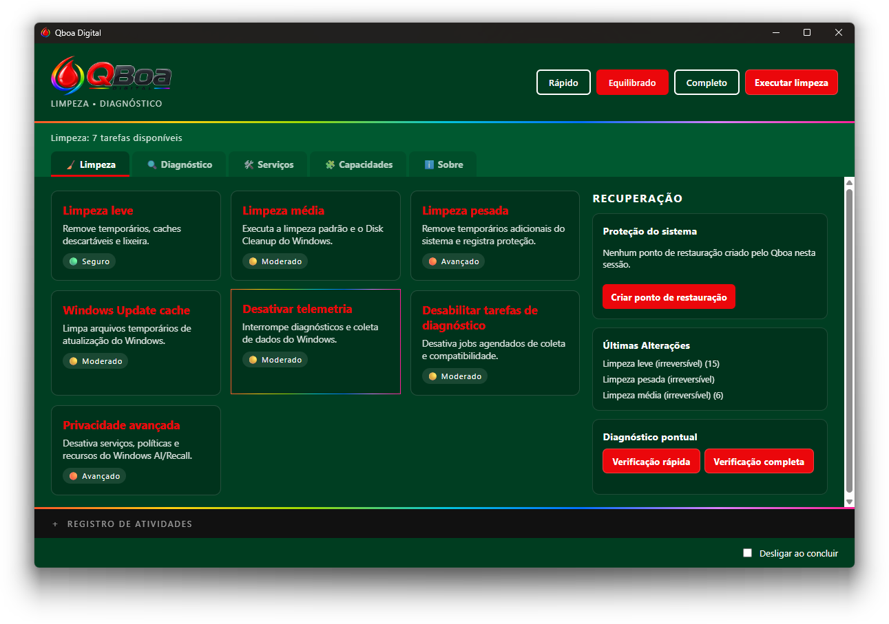
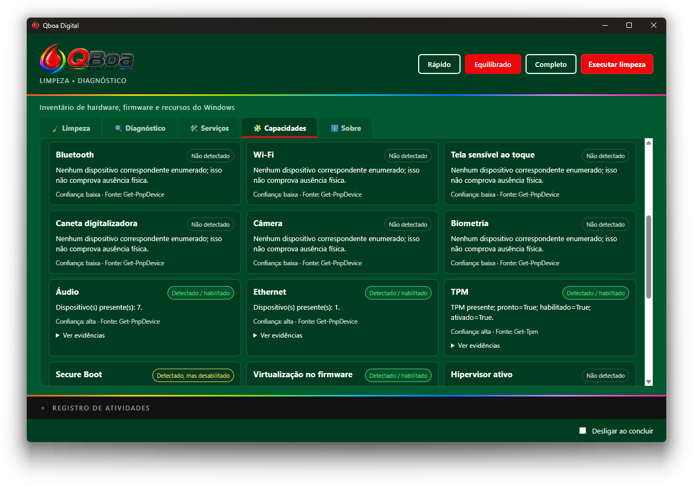
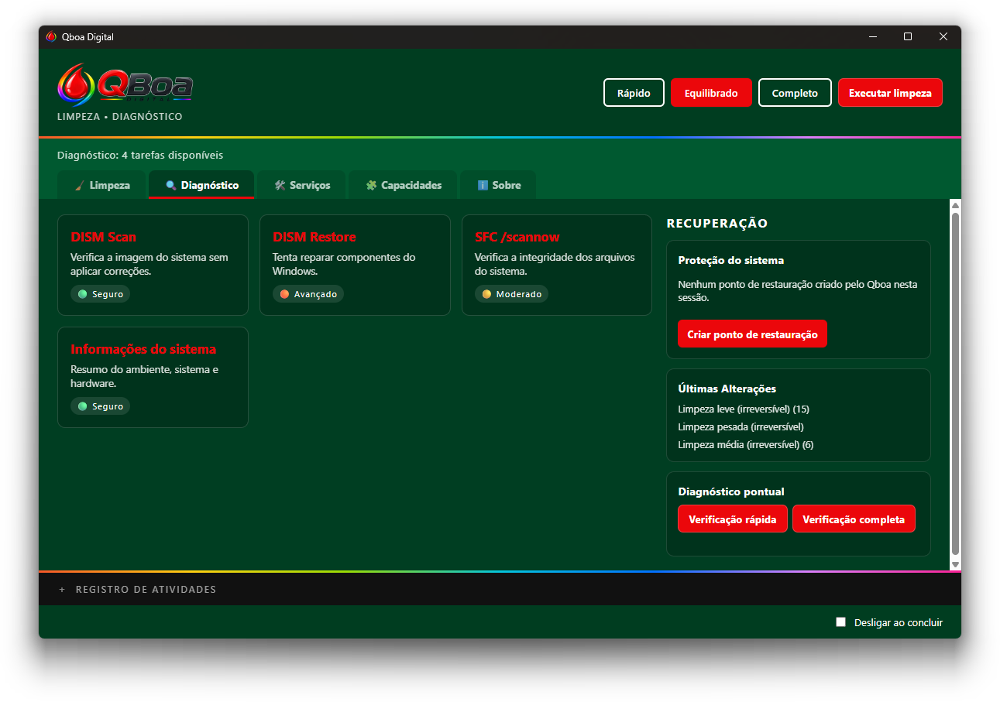
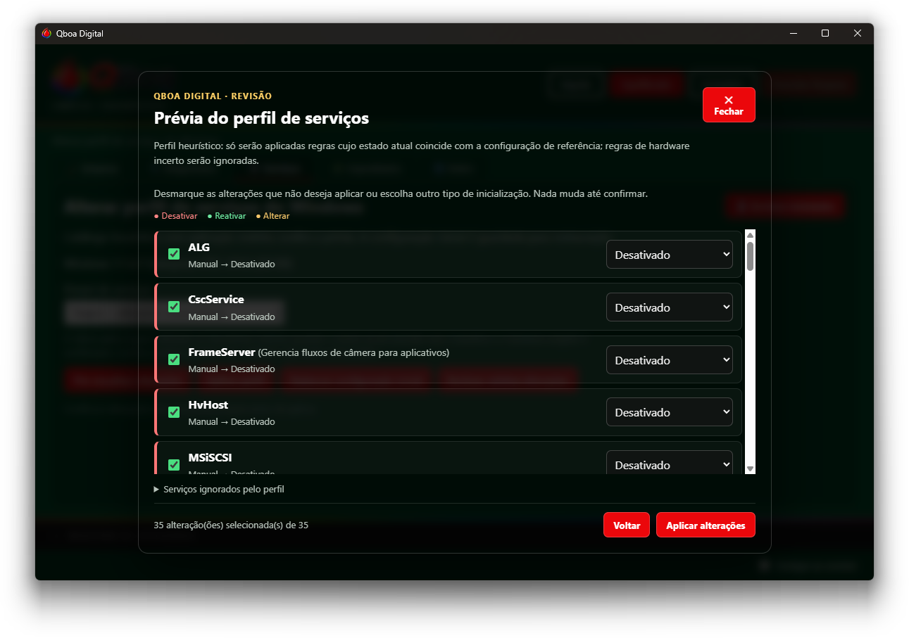

# QBoa Digital

Site oficial do **QBoa Digital**, um utilitário open source para limpeza, privacidade, diagnóstico e manutenção do Windows 10 e 11.

A versão **3.2.0** amplia os recursos de diagnóstico do QBoa Digital, com testes de integridade de RAM, carga e monitoramento térmico da CPU, estabilidade da GPU e laudos persistentes em JSON. O projeto continua a evolução do aplicativo desktop moderno desenvolvido com Tauri e Rust, com interface própria e ferramentas independentes de diagnóstico, limpeza e manutenção. O projeto começou com scripts BAT e hoje também oferece uma aplicação desktop integrada, mantendo acessíveis as versões legadas.

## Galeria de screenshots

Capturas de tela do aplicativo QBoa Digital 3.2.0. As imagens mantêm a transparência e a sombra original das janelas do Windows.

  
  
<strong>Limpeza</strong>

  
  
<strong>Capacidades do Windows</strong>

  
  
<strong>Diagnóstico</strong>

  
  
<strong>Serviços do Windows</strong>

## Baixe o QBoa Digital 3.2.0

A versão 3.2.0 está publicada para Windows x64. Escolha o instalador tradicional ou o executável portátil individual:

## Histórico de versões

### 3.2.0 — Diagnósticos avançados de hardware
- Testes de integridade da RAM com perfis de execução, inventário dos módulos, progresso e cancelamento.
- Teste de carga da CPU com monitoramento térmico e proteção contra condições inseguras.
- Teste de estabilidade da GPU baseado em Direct3D 11 Compute Shader, com validação independente e proteção térmica.
- Diagnóstico completo com aviso e confirmação prévios, progresso por etapa, cancelamento e resumo consolidado.
- Laudos JSON versionados, histórico local e preservação de resultados parciais em execuções interrompidas.
- Diagnósticos separados das ferramentas de limpeza e manutenção.

### 3.1.2 — Prévia de serviços mais confiável
- Corrige sugestões heurísticas de serviços no Windows 11 IoT Enterprise LTSC.
- Só sugere ajustes quando o estado atual do serviço coincide com a referência do catálogo; divergências são ignoradas.
- Identifica fornecedores conhecidos e mostra evidências, sem tratar a identificação como recomendação para desativar serviços.
- Mantém prévia e confirmação explícita antes de aplicar mudanças.

### 3.1.1 — Progresso e confirmações mais claras
- Painel de progresso centralizado, com contraste aprimorado e comportamento indeterminado quando não há percentual real.
- Confirmações e avisos de risco ficam em primeiro plano; o painel de progresso é ocultado enquanto há uma decisão pendente.
- Bloqueio de tarefas concorrentes na interface e no backend Rust.
- Descrições em linguagem simples para serviços conhecidos na prévia de ajustes.

### 3.1.0 — Mais visibilidade e controle
- Inventário de capacidades e recursos detectados no Windows.
- Gestão de serviços do Windows: consulta e ajustes compatíveis com as tarefas disponíveis, com registro do estado anterior para rollback quando reversíveis.
- Resumo das tarefas de limpeza, com indicação de sucesso, falha ou cancelamento.
- Aba **Sobre** com versão, autoria e QR Code Pix.
- Melhorias nos diálogos de confirmação, diagnóstico de armazenamento e leitura opcional de temperatura da CPU com provedor compatível.

### 3.0 — Nova geração desktop
- Transição dos scripts BAT para um aplicativo desktop com Tauri e Rust.
- Presets Express, Normal e Turbo.
- Limpeza, ferramentas de privacidade e telemetria, DISM e SFC.
- Confirmações para tarefas avançadas e proteções por pontos de restauração e rollback para alterações reversíveis.

As próximas versões 3.x serão adicionadas a este histórico quando publicadas. Versões de patch (por exemplo, 3.1.2) ficam reservadas para correções pontuais.

- **[Baixar instalador para Windows (x64)](https://github.com/bloodshinoda/qboa-digital/releases/download/v3.2.0/qboa-digital-3.2.0-x64-installer.exe)** — instalação tradicional.
- **[Baixar versão portátil para Windows (x64)](https://github.com/bloodshinoda/qboa-digital/releases/download/v3.2.0/qboa-digital-3.2.0-x64-portable.exe)** — executável portátil individual (.exe).
- [Notas da versão e arquivos da release 3.2.0](https://github.com/bloodshinoda/qboa-digital/releases/tag/v3.2.0)
- [Código-fonte do aplicativo](https://github.com/bloodshinoda/qboa-digital)

## Destaques da versão 3.2.0

- Diagnósticos de RAM, CPU e GPU com acompanhamento da execução.
- Laudos persistentes em JSON, histórico local e recuperação de resultados parciais.
- Diagnóstico completo com resumo consolidado.
- Separação entre diagnóstico de hardware e limpeza/manutenção.

## Destaques da versão 3.1.2

- Correção da prévia heurística de serviços em Windows 11 IoT Enterprise LTSC.
- Sugestões limitadas aos serviços cujo estado atual corresponde à referência do catálogo.
- Identificação transparente de fornecedores conhecidos, com evidências e confirmação explícita antes de qualquer alteração.

## Destaques da versão 3.1.1

- Painel de progresso e notificações com maior contraste.
- Confirmações priorizadas sobre o progresso para evitar sobreposição.
- Proteção contra execução simultânea de tarefas.
- Descrições amigáveis na prévia de serviços.

## Destaques da versão 3.1.0

- **Inventário de capacidades do Windows:** identificação e organização dos recursos disponíveis no sistema.
- **Catálogo de recursos e serviços:** informações organizadas para ajudar a entender melhor os componentes do Windows.
- **Experiência de uso aprimorada:** interface e apresentação das informações refinadas.
- **Área Sobre:** informações do projeto, versão e autoria, mantendo o QR Code Pix para quem quiser apoiar o desenvolvimento.
- **Execução controlada de tarefas:** o backend Rust valida as tarefas solicitadas pela interface e registra as execuções.

## Recursos do aplicativo

- Limpeza de arquivos temporários e caches selecionados.
- Ferramentas de privacidade e ajustes relacionados à telemetria.
- Diagnóstico e manutenção do Windows com DISM e SFC.
- Presets de execução Express, Normal e Turbo.
- Proteções para operações avançadas, incluindo pontos de restauração quando disponíveis, snapshots e rollback para alterações reversíveis.
- Registro técnico e possibilidade de cancelar a execução de tarefas compatíveis.

Operações como limpeza de arquivos, verificações e reparos do Windows não possuem rollback granular. A disponibilidade de pontos de restauração depende da configuração do próprio Windows. Leia as informações e confirmações apresentadas pelo aplicativo antes de executar tarefas avançadas.

## Versões legadas BAT

As versões anteriores permanecem disponíveis para quem prefere os scripts originais:

- **[QBoa Digital 1.0 BAT](download/qboa-digital-1.0.zip)** — versão legada para rotinas simples.
- **[QBoa Digital 2.0 BAT](download/qboa-digital-2.0.zip)** — evolução dos scripts com rotinas adicionais de otimização.

O 3.1.0 é uma nova geração do projeto, não uma descontinuação da história do BAT: mantém o propósito original em um aplicativo desktop mais integrado.

## Repositórios

- [Código-fonte do aplicativo e releases](https://github.com/bloodshinoda/qboa-digital)
- [Repositório deste site](https://github.com/Qboadigital/qboadigital.github.io)

## Política de versões

A linha de versões estáveis segue uma sequência incremental:

- **3.0**, **3.1**, **3.2**… para versões com novas funcionalidades e melhorias.
- **3.0.1**, **3.0.2**… apenas para correções pontuais da versão correspondente.

## Licenças

O conteúdo deste site é licenciado sob a [Creative Commons Attribution-ShareAlike 4.0 International (CC BY-SA 4.0)](LICENSE). Você pode compartilhar e adaptar o material, desde que atribua a autoria e distribua eventuais adaptações sob a mesma licença.

O aplicativo QBoa Digital e seu código-fonte são licenciados sob a GNU General Public License v3.0 (GPL-3.0). Consulte o [repositório do aplicativo](https://github.com/bloodshinoda/qboa-digital) para os termos e o código-fonte correspondentes.
